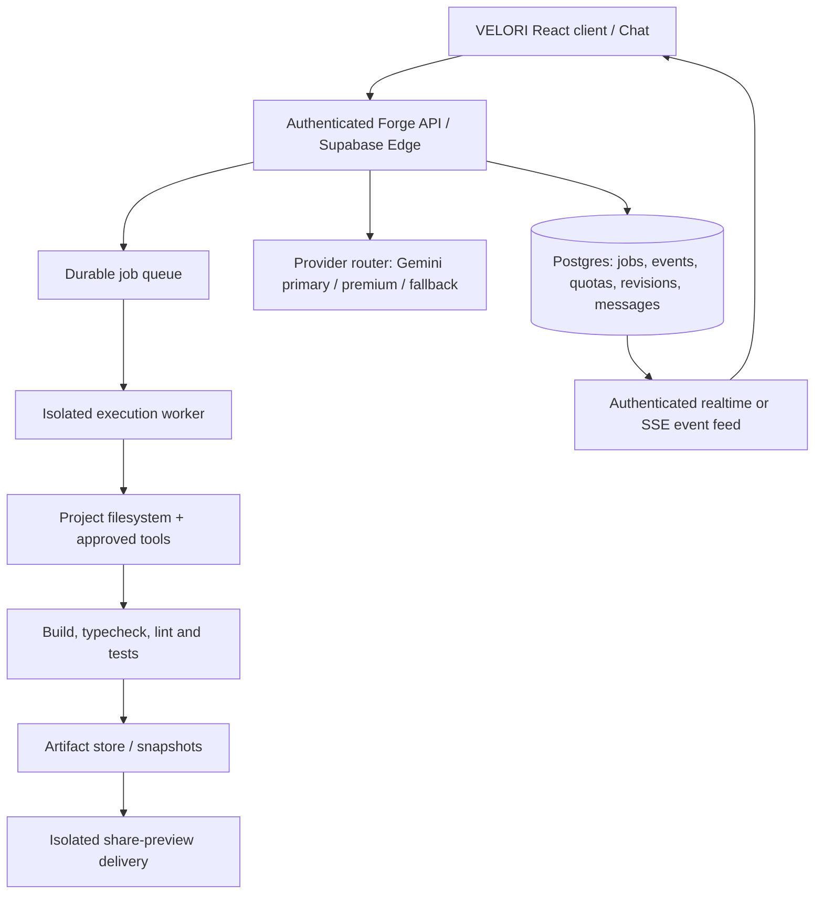

# VELORI V33.1 — Production Engineering, Product and UI Blueprint

**Product:** VELORI Social Platform  
**AI product:** FORGE AI  
**Parent brand (as specified by the product owner):** VELORYZ  
**Release target:** V33.1  
**Document edition:** 2026-10-26  
**Owner role:** Product engineering lead / principal architect  
**Artifact status:** **IMPLEMENTATION SPECIFICATION, NOT A DEPLOYED RELEASE**

> **Source truth:** The accessible full downloadable source is `VELORI_V31_COMPLETE_REDESIGN_SOURCE.zip`. The Library additionally holds `VELORI_V33_1_MERGE_PATCH.zip` and `VELORI_V33_1_RELEASE_NOTES.md`; those files explicitly state their modifications were based on V31, not merged with live V33 and not published. No authenticated Work V33 project source or connected GitHub VELORI repository was exposed in this chat. The connected Supabase backend was inspected separately. Obtain the actual V33 source, compare its commit and migrations, and merge deliberately; **do not replace the live V33 tree with V31**. This document defines the complete target, including work not yet built.

## 0. Product-executive decisions and corrections

1. The correct platform name is **VELORI** and the AI product is **FORGE AI**. Retain **VELORYZ** as the stated parent brand; resolve legal rights-holder identity before publishing legal notices.
2. **Bolt.new is a commercial product, not simply an open-source library.** The public `bolt.diy` project is open source under MIT, but its WebContainer runtime has distinct commercial-use terms. For a production VELORI application, borrow permitted engineering patterns or licensed components, preserve required third-party notices, and obtain a runtime license or provide an independently licensed isolated runner. Do not imply the entire VELORI product is secretly "powered by" another provider; user-visible branding may be solely VELORI/FORGE AI where contractually permitted.
3. **Gemini is an LLM, not an operating system, package manager, build runner, or deployment service.** A full-stack AI builder requires safe tools, a real project filesystem, a package executor, durable state, preview serving, build/test loops and approval gates.
4. "Show everything inside chat" means the **conversation is the control plane**: user prompts, follow-ups, real progress, errors, approvals and result cards appear inline. A preview, file tree, code editor and terminal can still be displayed in an adjacent *workspace pane*. There must not be hidden action buttons or unexplained errors in an unrelated section.
5. **Audio does not become embedded in an image post.** Photo posts can have a licensed, linked soundtrack that plays in the feed. Video/story/reel audio intended to survive export needs a real media-muxing pipeline or a playable manifest; saving only a track name is insufficient.
6. **Copyright is not transferred to VELORYZ by adding a notice or forcing a watermark.** Distinguish original platform IP, user inputs, generated outputs, imported open-source dependencies, stock/music licenses and possible third-party rights. Define product terms and licenses clearly and obtain qualified legal review. Free-tier attribution/brand badges are a separate contractual feature.
7. **No downloaded editable source can have an unremovable watermark in a technically reliable way.** Enforce free-branding in hosted preview/build delivery and license terms; never claim client-side JavaScript makes branding tamper-proof. Premium attribution removal must be tied to verified paid entitlement, not to a frontend toggle.
8. **Provider limits are external.** Increasing VELORI's daily provider cap will not increase Gemini RPM/TPM/RPD or spending limits. A robust policy must distinguish provider 429, user allowance, tenant cap and temporary infrastructure saturation.
9. Do not claim "unlimited" Premium AI generations when provider limits, cost caps or fair-use protections still exist. Published pricing must match billing configuration and legally reviewed plan terms.
10. No feature is classified "completed", "verified", "production-ready", or "live" from a mockup or a model response alone. Require source diff, migrations, tests, staging validation and deployment evidence.

## 1. Release outcome: what V33.1 MUST deliver

### P0 — cannot release without

- [ ] Reel soundtrack persists from music picker into the published reel, preview and final playback/export with correct mix and duration.
- [ ] Story soundtrack persists through composer -> renderer -> upload -> playback and does not lose the image/video background.
- [ ] Post music is published through a licensed soundtrack association and plays when the viewer explicitly activates it.
- [ ] Story viewer groups moments by **author**; swiping horizontally changes authors, while taps/automatic progression advance moments within that author.
- [ ] FORGE AI opens in a unified chat-first workflow. Every prompt, question, permission request, build status, warning and result appears inside that chat.
- [ ] Generation requests never silently fail, never double-charge, and have durable IDs, cancellation and retriable state.
- [ ] Real agent progress originates in durable backend events; do not fake "reading source", "installing packages" or "testing" messages unless those actions actually occurred.
- [ ] User, plan and provider quotas are visible, enforced on the server, and differentiated in errors.
- [ ] Users can download a project ZIP containing complete **actual created files**, dependencies, README, applicable licenses and asset references for its selected supported framework.
- [ ] Shareable preview links are permissioned, revocable, rate-limited, properly branded by tier and isolated from the user's VELORI account/session.
- [ ] Free attribution and Premium removal rules use verified entitlements; copyright/ownership disclosures are accurate.
- [ ] Secrets, generated code and runtime commands are isolated, audited and resistant to cross-user access.
- [ ] All affected routes operate on Android/mobile and desktop with accessible controls.

### P1 — expected polish for V33.1

- [ ] Source diff approval, revision history, rollback and project checkpoints.
- [ ] Searchable chat history, attachment insertion, thumbnails and project-resume navigation.
- [ ] Context-preserving follow-up edits ("change the header", "keep everything else").
- [ ] Responsive app/presentation templates, context-aware AI questions, animation test support.
- [ ] Admin monitoring for provider health, quota usage, model routing, publishing failures and music catalog errors.
- [ ] Media draft recovery, autoplay fallbacks, loading skeletons and mobile-first safe-zone design.

### Conditional full-stack build capability (NOT achieved by a UI patch)

A legitimate V33.1 full-stack builder requires the sandbox-runner subsystem described in Sections 4–6. If that worker infrastructure, license review, security testing and production resource budgets are not ready, keep the feature behind `forge_fullstack_runner` as an **explicitly labeled beta/unavailable capability**; ship reliable static-site/studio improvements instead of representing them as full stack.

## 2. Existing architecture / integration points verified in accessible code

**Accessible V31 React/Vite source:**

```
src/features/artifacts/Assistant.tsx       FORGE chat/assistant interface
src/features/artifacts/Workspace.tsx       FORGE project workspace
src/features/artifacts/StudioPage.tsx      route composition
src/features/artifacts/Preview.tsx         code/project preview
src/features/artifacts/CloudControls.tsx   cloud/account controls
src/features/artifacts/api.ts             Supabase Edge request client
src/features/artifacts/model.ts           project and message models
src/features/artifacts/studio.css         FORGE design rules
src/features/stories/StoryExperience.tsx  multi-author story viewer
src/features/stories/navigation.mjs       story gesture recognition
src/features/creator-studios/             post, reel, story creation UI
src/features/creator-studios/services/compose-post.ts  post media composer
src/lib/reel-editor/render-reel.ts       reel rendering
src/lib/story-editor/export-renderer.ts  story export
supabase/functions/velori-studio/         Gemini-backed generation API
supabase/functions/reel-export/           reel export function
supabase/migrations/                     schema and RLS
```

**Available V31-based V33.1 reference patch:** adds author-scoped story navigation tests, post soundtrack picker/playback/migration, reel/story audio error handling, FORGE chat notices and static-project ZIP export. Use this only as a source of *individual changes to rebase*, not a full V33 replacement. The accompanying patch report says 272 tests passed, one skipped, some dependency-based suite excluded; this is not production acceptance.

**Current backend understanding:** the deployed `velori-studio` Edge Function reads `GEMINI_API_KEY`, `VELORI_GEMINI_MODEL`, optional premium/fallback models, `VELORI_STUDIO_GENERATION_ENABLED`, `VELORI_STUDIO_DAILY_PROVIDER_CAP` and `VELORI_STUDIO_ENCRYPTION_KEY`. Its current generation contract expects a JSON project with `title` and `pages` including `path`, `html`, `css`, `js`. It is *not* a general-purpose file-writing terminal agent. Keep the existing path functional while adding a versioned full-stack route.

### Target dependency boundary

Do **not** replace the existing React/Vite/Supabase social platform. Add an isolated FORGE developer runtime as an opt-in subsystem. Stories/music may require new database columns/tables but must preserve existing post/story/reel IDs, likes, notifications, comments, RLS, CDN and mobile clients.

## 3. Product information architecture / new interface

### User routes

| Route | Goal | Essential elements |
|---|---|---|
| Existing FORGE route (retain V33 path) | AI project conversation | project selector, threaded chat, prompt composer, approval cards, real progress |
| Existing FORGE workspace | live project | files, code, preview, console, revisions, deploy, download |
| Existing project shares | public/private preview | revision snapshot, license-aware badge, expiration, report, copy link |
| Existing story route/viewer | per-author story sessions | author identity, own segments, next-person swipe, controls |
| Existing reel/post/story studio routes | compose and publish | media canvas, licensed music, trim, gain/mute, final preview |
| Existing admin routes | operational control | secrets, models, quotas, plans, assets, music rights, job logs |

Do not invent a brand-new route path before inspecting V33's `routes.tsx` or router registry; reuse its current routing conventions.

### Desktop UI wireframe (>=1200px)

```
┌────────────┬──────────────────────────────────┬────────────────────────────┐
│ VELORI     │ FORGE AI / Project: Nexus        │ WORKSPACE                   │
│ Projects   ├──────────────────────────────────┤ Files | Preview | Code     │
│ + New      │ USER: Build a portfolio           │                            │
│ Recent     │                                  │ src/                       │
│ Favorites  │ FORGE: I can build it in React.  │   App.tsx                  │
│ Templates  │ [Confirm stack] [Change]         │   styles.css               │
│ History    │                                  │ package.json               │
│ Settings   │ ✓ Plan saved                     │                            │
│            │ ● Creating files (3/7)           │ [App renders here]         │
│            │ □ Installing deps                │                            │
│            │ □ Running checks                 │ [Console / diff drawer]    │
│            │                                  │                            │
│            │ ┌────────────────────────────┐   │                            │
│            │ │ Message or ask FORGE…      │   │                            │
│            │ │ [attach] [send] [stop]      │   │                            │
└────────────┴──────────────────────────────────┴────────────────────────────┘
```

**Workspace split:** left 232–256px collapsible navigation; conversation 380–680px fluid; workspace `minmax(420px,1fr)`. The chat stays the operational source of truth. Tabs in the right pane are only views, not alternative places where errors or user questions appear.

### Tablet (768–1199px)

- Collapsed icon nav; conversation and workspace in resizable split; right side converts to tabbed drawer if width is insufficient.
- Chat composer always remains visible while keyboard is open; no scroll hijacking.

### Mobile (320–767px)

- Header: back, project title, sync state, overflow actions.
- Segmented views: **Chat | Preview | Code**. Default Chat; preview shown only when selected or after an explicit result-card tap.
- Composer above system keyboard and safe-area inset; 44px minimum tap targets.
- Inline progress cards use compact text; nested command logs expand on demand.
- Files, diff, console, export and share open full-height sheets with persistent close action.
- On reconnection, restore transcript scroll position, unsent message and pending action safely.

### Design tokens (matches accessible V31 editorial intent)

```
--surface-base: #FAF9F6;
--surface: #FFFFFF;
--text-primary: #171717;
--text-muted: #666666;
--border: #E7E5E1;
--brand-accent: #E7B94C;
--success: #166534;
--warning: #9A6700;
--danger: #B42318;
--radius-card: 16px;
--radius-control: 12px;
--space-1: 4px; --space-2: 8px; --space-3: 12px;
--space-4: 16px; --space-6: 24px; --space-8: 32px;
```

Use dark mode via tokens only. Animations 120–240ms for controls, 200–400ms for page/preview transitions; transform/opacity primarily, reduced-motion alternatives and visible keyboard focus. Avoid excessive glass, fake terminal animations, giant gradients and unrelated branding.

### Chat message taxonomy: every important activity appears here

| Message type | Example | Source of truth |
|---|---|---|
| User prompt | "Build a landing page" | persisted conversation turn |
| Assistant clarification | "React or static HTML?" + options | real model response |
| Plan approval | "I'll edit 4 files" + Approve/Edit | server-bound approval token |
| Tool start | "Reading src/App.tsx" | `forge_run_events` row |
| Tool completion | "Updated src/App.tsx" + diff | committed artifact/diff |
| Build activity | "pnpm build running" | runner stdout/stderr event |
| Warning | "Gemini rate-limited; retry available" | normalized provider error |
| Permission | "Allow write to project files?" | pending permission request |
| Quota | "3 of 10 plan generations remaining" | server quota snapshot |
| Result | preview, branch/revision, download/share | verified artifact link |
| Follow-up | "Change background to cream" | new revision referencing prior |

No staged 'Thinking/Reading/Building' narrative without a corresponding real backend state; UI may use generic 'Request received' on request start because that event is verifiable.

## 4. FORGE AI V33.1 target architecture



### What runs where

- **Client:** React/Vite page shell, chat, file tree/editor, read-only previews, user approvals; never receives provider master key, Supabase service-role key or privileged worker credentials.
- **Edge API:** verifies Supabase session, validates input and entitlement, stores messages/jobs, applies rate limits, invokes provider services, signs runner requests, authorizes shares; intended to stay short-lived.
- **Postgres:** authoritative state, audit, run events, consumption ledger, project snapshots and RLS. No arbitrary executed source in SQL triggers.
- **Queue:** durable, cancellable, at-least-once delivery with idempotency.
- **Runner:** separately deployed sandbox/VM/container per job or carefully isolated session. Explicit CPU, RAM, disk, time, process, file and network controls. Runtime-appropriate package manager and test tools.
- **Preview:** isolated origin, sandboxed iframe, no implicit access to VELORI cookies, storage or secrets. Hosted previews use dedicated domain and policies.

### Production constraints

- A Supabase Edge Function is appropriate for API/auth/orchestration; **not** the unlimited-time shell runner for npm installs or arbitrary user code.
- Runtime engine choice is a commercial/security decision: licensed WebContainer API *or* isolated server-side containers/microVMs. The first option needs its terms checked; the second needs significant infrastructure and security work.
- Add `forge_fullstack_runner` feature flag. Existing safe static HTML/CSS/JS generator stays available during staged rollout.
- Use a versioned run contract; avoid trying to force a multi-file full-stack project into the old `pages[{path,html,css,js}]` shape.

## 5. Agent workflow, approvals, streaming and durable events

### Complete agent state machine

```
DRAFT
  -> SUBMITTED
  -> AUTHORIZED / BLOCKED (auth/plan/cap)
  -> ANALYZING (fetch approved source/context)
  -> CLARIFYING (only if essential)
  -> PLANNING
  -> AWAITING_APPROVAL (for sensitive side effects)
  -> EXECUTING (read/write/install/build/test, loop with caps)
  -> VERIFYING (compile/tests/preview)
  -> COMPLETED / FAILED / CANCELLED / QUOTA_PAUSED / AWAITING_USER
```

### Tool protocol (server validates all arguments)

```
plan.create              -> bounded plan steps with expected files
project.files.list       -> metadata within the authorized project root
project.files.read       -> allowlisted paths, size caps, secrets masked
project.files.write      -> patch/diff, atomic writes, conflicts checked
sandbox.command.run      -> sandbox-only allowlisted tools, TTL + max output
checks.typecheck         -> instrumented compile result
checks.build             -> instrumented build result
checks.test              -> instrumented test report
preview.publish          -> isolated, revision-specific preview
project.snapshot         -> immutable revision
artifact.export          -> complete ZIP with declared provenance
approval.request         -> inline user interaction and signed decision
run.cancel               -> revoke sandbox job and stop billing accrual
```

**Tool invocations are issued by the server orchestration layer, not by generated JavaScript in a preview.** Gemini's function-call suggestions must be parsed against JSON Schemas, checked against user rights and actually executed by the application. Reject unknown tool names and paths. Model output is untrusted.

### Example event contract

```ts
export type ForgeRunEvent = {
  id: string;                     // UUID for event replay/dedupe
  runId: string;                  // foreign key to authorized run
  sequence: number;               // monotonically increasing per run
  timestamp: string;              // server UTC
  kind: 'request_received' | 'analysis' | 'plan' | 'clarification' |
        'approval_requested' | 'tool_started' | 'tool_finished' |
        'build_started' | 'build_result' | 'test_result' |
        'preview_ready' | 'quota_warning' | 'provider_error' |
        'assistant_message' | 'run_completed' | 'run_failed' | 'run_cancelled';
  visibleText: string;             // user-safe and sanitized
  status: 'queued' | 'running' | 'success' | 'warning' | 'error' | 'action_required';
  projectRevisionId?: string;
  toolCallId?: string;
  detailsRef?: string;             // server-authorized details retrieval only
  retryAfterSeconds?: number;
};
```

### Request API examples (target contracts, not current endpoints)

```
POST /forge/v2/projects/:projectId/runs
  {clientRequestId, message, mode, attachments[], basedOnRevisionId}
  -> {runId, acceptedAt, streamUrl, quotaSnapshot}

GET /forge/v2/runs/:runId/events?after=123
  -> ordered events (SSE or authenticated incremental HTTP)

POST /forge/v2/runs/:runId/decisions
  {approvalId, decision:'approve'|'deny', approvedScope, nonce}

POST /forge/v2/runs/:runId/cancel
  -> cancellation accepted; last good project revision preserved

GET /forge/v2/projects/:projectId/revisions/:revisionId/export
  -> authorized short-lived download URL
```

### Run guarantees

- Generate stable `clientRequestId` on submission; prevent rapid double clicks and network retries from creating double jobs.
- Persist user message before calling model; all final output and errors follow events with monotonically increasing sequence IDs.
- Retry only idempotent operations; preserve the same request ID after ambiguous failure. Never double-consume quota.
- User can stop; stop signals propagate to provider request and executor, with reliable cleanup.
- Never persist raw service secrets in event payloads, user chat, files, console or metrics.
- A run modifying project files works against a snapshot/branch; writes must be atomic. On failure, current published revision stays intact.
- Follow-up edits supply latest accepted revision, relevant files, summarized context and conversation history with user consent; protect against inadvertent rewrite of unrelated pages.
- Max depth/tool calls/token budget/CPU budget are enforced; stop asking model to retry endlessly after malformed response.

## 6. Supported creation modes and downloadable source

### Modes shown to user

| Mode | Output | Required execution infrastructure |
|---|---|---|
| Presentation | self-contained HTML/CSS/JS slides, media, controls | existing static generator / preview |
| Animated website | static multipage HTML/CSS/JS or supported React | static pipeline; React requires build worker |
| Frontend app | React/Vite + TypeScript, CSS, assets, tests | build worker |
| Full-stack app | approved frontend + backend, database/migration proposal | isolated tool-runner + integration approvals |
| Python project | valid Python files, requirements, run instructions | Python runtime-specific runner, if available |
| Existing project edit | minimal diff to supplied/owned source | source import + revision/diff tools |

Avoid promising *all languages and frameworks at launch*. The UI must state support based on tested runtime images and available templates. Unknown stacks can be generated as source only and labeled "not executed" until validated.

### Export ZIP contract

```
project-name/
  README.md                setup, run, build, deploy and limitations
  LICENSE-INFO.md          VELORI obligations and third-party inventory
  .env.example             variable names only, never secret values
  package.json             when Node/React project
  lockfile                 for deterministic dependency versions
  index.html               for Vite/static projects
  src/**                   all generated source files
  public/assets/**         assets user owns/is licensed to redistribute
  tests/**                 any generated/verified tests
  forge-manifest.json      model, project type, revision, provenance, tier
  ATTRIBUTION.md           if applicable under plan and licenses
```

- ZIP must come from the **saved artifact tree**, not a fabricated set of AI answers pasted into a string.
- Include user-provided assets only when authorized for export; exclude private media and copyrighted tracks unless the relevant license permits redistribution.
- Exclude `.env`, cloud access tokens, service role secrets, cached login cookies, `node_modules`, `.git` secrets, runtime logs and binaries that do not belong to the deliverable.
- Record build status accurately: `verified_build`, `source_only`, or `build_failed`.
- Permit free users to download source if product policy says so, with a disclosed license/attribution obligation; paid entitlements may remove **VELORI's contractual attribution** but never third-party license notices.
- Serve ZIP via short-lived signed URL with user/owner authorization; use content disposition, limits, malware/safety scan where applicable.

## 7. Shareable project previews

### State and permissions

- Visibility: `private` (default), `unlisted`, optional `public` if explicitly supported and moderated.
- Share creates immutable preview snapshot and random unguessable token, stores token hash, expiry, owner, project revision, plan entitlement snapshot, active/revoked state and view counters.
- Private previews require authorized login; unlisted previews require the link; public listing is separate consent.
- A share never exposes personal account session, unpublished source secrets, direct Storage private buckets or unapproved backend connections.
- Owner can copy, refresh, revoke, set expiry and optionally password-protect. Expired/revoked return accurate states.
- Require robots noindex for unlisted by default; abuse report and traffic throttles.
- Preview runtime uses strict CSP/sandbox, dedicated origin, bounded network privileges and potentially read-only placeholder services.

### Free vs Premium badge

- Free shared preview carries a tasteful but visible `Made with FORGE AI by VELORI` badge outside user-controlled iframe content wherever possible.
- Premium verified at share issue time and/or preview serve time according to published terms; authorized removal of **VELORI attribution only**.
- Server must not trust a client field such as `isPremium:true` or `hideWatermark`.
- Preserve legal third-party notices and user rights; do not inject false `Copyright © VELORYZ` claims into all user-generated files.
- Downloaded source and exported static websites are editable; explain that technical prevention of badge removal is not guaranteed.

## 8. Quota architecture, provider fallback and cost safety

### Four different limits

1. **User/plan allowance:** durable purchases/credits and fair-use enforcement; scoped by user and plan.
2. **Daily site/provider budget:** operator-set spend cap / request cap; scoped to VELORI tenancy.
3. **Actual Gemini API limitations:** requests per minute, tokens per minute, requests per day and spending tiers; vendor-set, cannot be raised by changing VELORI admin value.
4. **Runner capacity:** concurrent projects, job queue, CPU/RAM-minute budget, storage and preview egress.

### Required chat notices

- `USER_QUOTA_EXHAUSTED`: "You've used the generation allowance on your current plan. Your projects and previews remain available." Action: see usage/plan (only if actually offered).
- `PROVIDER_RATE_LIMITED`: "AI provider is temporarily rate-limited. Retry is available after the shown delay." Do not imply Premium bypasses this.
- `SITE_BUDGET_PAUSED`: "FORGE generation is temporarily paused by service capacity policy." Don't suggest buying credits to bypass.
- `RUNNER_AT_CAPACITY`: "Build workers are full; request queued/cancellable." Provide real queue position only if known.
- `MODEL_UNAVAILABLE`: "Configured model did not respond. No files were changed." Retry/fallback based on policy.
- `PAYMENT_NOT_CONFIRMED`: never mark Premium active until verified provider webhook and ledger transaction.

### Implementation details

- Use transactional reserve/commit/release semantics and idempotency; store every credit operation and provider usage record.
- Separate soft UI indications from hard enforcement in database-backed RPC/service handlers.
- Model routing policy: primary/paid/fallback model IDs and supported capabilities configured in admin, validated with a small authenticated generation health check; `GET model` validation alone cannot prove inference quota.
- Model fallback only for eligible transient failures and approved data processing rules. Avoid costly cascade storms on 429 or exhausted quotas.
- Exponential backoff with jitter and vendor `Retry-After` when present, capped retries; don't retry invalid request/auth/payment errors blindly.
- Admin counters must show UTC reporting period, user-local display, provider-specific period and reset policy. Google RPD may reset on Pacific-time schedule; do not hardcode midnight India.
- Preserve current `VELORI_STUDIO_DAILY_PROVIDER_CAP` semantics during migration. Never silently reset balances or quota histories.
- Track estimated and actual tokens/provider charges, worker seconds, storage bytes, error rate and cancellation.

## 9. Media system V33.1 — one catalog, three creator experiences

### Canonical music catalog

Use the existing `studio_music_tracks` schema as the starting point; inspect live V33 schema before changing it. Each track should have (or be associated with): `id`, title, artist, owner/publisher, approved usage scopes (`post`,`story`,`reel`), audio asset ID, duration, sample/playable excerpt rules, territories where relevant, explicit-content/maturity metadata, rights evidence/license type, attribution requirement, expiry/takedown status, publication state, waveform optional, and safe playback metadata. **Only tracks with verified usage rights should appear as publishable.**

### Common soundtrack selection model

```ts
type SelectedSoundtrack = {
  trackId: string;
  licenseScope: 'post' | 'story' | 'reel';
  mediaOffsetMs: number;          // point in target content
  trackStartMs: number;           // trim inside track
  durationMs: number;
  volume: number;                 // 0..1
  originalAudioVolume: number;    // if video media present
  fadeInMs: number;
  fadeOutMs: number;
  previewVersion: number;
};
```

The chosen track ID and editing values are part of the saved draft, publish request and canonical published object. Reference short-lived media URLs only at consumption time; never persist expiring signed URLs as the permanent soundtrack identity.

### Post studio — expected workflow

1. Select image(s)/video and make a post draft.
2. Tap **Add music**; licensed search and preview; choose a track and trim range.
3. Show a small audio chip under the canvas (`Song • Artist | Change | Remove`); indicate post playback is viewer-controlled.
4. Review before publish: chosen track, excerpt and audience permission.
5. Publish post media first or in a transactionally safe state machine; bind `post_id` to `track_id` in a new association relation, with proper rollback/repair and RLS.
6. On feed detail, fetch rights-cleared playable URL through authorized function/storage policy and play only after a user gesture. Pause on exit, tab hidden, other media playback; allow mute and seek where permitted.
7. If soundtrack association fails, do **not** silently claim the music is attached. Keep draft intact, offer retry or explicit Publish without music.
8. A photo downloaded as JPG/WebP cannot include audible music; clearly differentiate "post with soundtrack" versus rendered MP4 export.

### Reel studio — expected workflow

1. Pick licensed track and trim to reel duration, preserve original-video-audio volume and music gain.
2. Provide live media-synced preview using a shared audio clock; play/pause/scrub/seek updates both video and music.
3. For video export, use a supported, validated audio mixer/muxer (browser Web Audio + MediaRecorder/WebCodecs where supported, or a restricted server-side media worker). Detect codecs and sample rate; never call a silent video "audio exported".
4. Encode/retrieve the final playable asset before marking publish complete. Upload idempotently and verify duration, audio track presence, first and last seconds, A/V sync.
5. Errors must retain draft and surface in editor/chat-like status; no silent drop of audio on decoder failure.

### Story studio — expected workflow

1. Background media (image/video) must render into the composed asset; fix the known "only background color visible" failure by verifying asset load, layer order and canvas CORS-safe draw.
2. License-checked track selection and excerpt control persist across signed-URL refresh.
3. Preview renders true selected background/overlays; music uses shared clock and user-initiated preview when browser autoplay is restricted.
4. Export image+music as video when the intent is a self-contained audiovisual story; otherwise publish a story media asset plus soundtrack metadata and play synchronously using supported renderer.
5. Ensure stickers, text, mentions and layers survive the export path. Audio source errors block an alleged successful audio export.

### Browser and rights constraints

- Most mobile browsers restrict sound autoplay until interaction. UI must offer a visible unmute/play control, not hide this as a bug.
- Storage signed URLs expire; obtain a fresh authorized URL for playback/export and respond to errors without leaking private buckets.
- MP3/AAC/Opus/MP4 support differs by platform; test supported device/browser matrix, use server transcoding when necessary.
- User uploads and commercial music require content rights. Do not redistribute licensed music files in publicly downloadable source ZIP without express rights.

### Media QA acceptance

- Selection survives navigate away/back, reload draft, publish, app reload and cross-device viewing.
- Selected timestamp/duration on preview matches the published result within defined A/V tolerances.
- User sees exact correction action when asset unavailable, license revoked, codec unsupported or URL expired.
- No playback from offscreen feed item; audio focus arbitration prevents overlapping clips.
- Verify on Android Chrome, iOS Safari, desktop Chrome/Firefox/Edge, low-bandwidth mode and interrupted uploads.

## 10. Story viewer — separate authors, coherent gestures

### Required data model

```ts
type StoryAuthorSession = {
  authorId: string;
  username: string;
  avatarUrl: string | null;
  moments: Array<{ id: string; mediaUrl: string; durationMs: number; createdAt: string }>;
};

type StoryPlaybackPosition = { authorIndex: number; momentIndex: number };
```

### Navigation rules

- The tray displays author avatars. Opening an avatar sets `authorIndex` to that author's session and `momentIndex=0` (or the first unseen moment according to product policy).
- Top progress rail has **one segment per story from the active author**, not a combined sequence of all users' moments.
- Tap right: next moment from **same author**; at last moment, move to first moment of next author.
- Tap left: previous moment from same author; at first moment, move to previous author as product policy specifies.
- Horizontal swipe left/right: **next/previous author**, regardless of current author's moment count; reset correct moment index.
- Long press: pause. Release resumes without speeding. Swipe down/close: dismiss viewer and return to tray.
- Automatic playback: next moment same author -> next author on boundary -> close at end.
- Desktop keyboard: optional arrows, Escape close, Space pause respecting screen-reader focus.
- Mute state/volume persists across author transitions within viewer, but no unwanted autoplay in browsers restricting audio.
- Independently scope viewers, blocks, private-account policy, deletion/takedown, mention actions and analytics to each moment/author.

### Must-not-happen regressions

- Progress segment count equals all users' stories.
- A horizontal swipe plays the next story moment of the same author.
- Story replies or mentions leak across authors.
- Deleted or private moments appear in an unauthenticated share.
- Last-author swipe crashes/loops unexpectedly.

## 11. Admin / operations console

### Recommended admin sections

1. **AI Providers & Models:** Gemini primary, optional premium and fallback model IDs, authenticated probe, supported capabilities, health state, secret rotation and versioned setting changes. Key values are never displayed after saving.
2. **FORGE Availability:** global studio enabled, generation enabled, static studio vs full-stack runner feature flags, queue health, no silent "true" string-vs-boolean mismatch.
3. **Quota & Spend:** per-plan allowance, daily provider cap, global cost budget, concurrent jobs, worker budgets, model usage and provider 429 breakdown. All changes create audit events.
4. **Jobs & Agent Events:** searchable by run ID, user (role-appropriate), state, errors, build log excerpts and correlation ID; redact private prompts/PII from standard operations screen.
5. **Plan & Entitlement:** plans/price mappings, payment verification, cancellation/refund state, attribution eligibility, versioned published plan terms.
6. **Music Library:** upload/replace licensed track, use scope, duration, preview, attribution, rights evidence, expiry/takedown, moderation and preview quality.
7. **Preview & Shares:** expiration, revocation, abuse reports, free watermark policy, origin restrictions and outbound traffic settings.
8. **Security & Access:** admin roles, reauthentication for sensitive settings, webhook status, key rotation, action audit, origin allowlist.
9. **Content & Brand:** VELORI first-party assets/logos, CMS text, terms and disclaimers, no ownership misstatements.

### Secrets/config matrix

| Key / capability | Location | Rule |
|---|---|---|
| `GEMINI_API_KEY` | protected Supabase/function secret | server only, never source/chat |
| `VELORI_GEMINI_MODEL` | protected configuration | validate supported model and generation |
| `VELORI_GEMINI_PREMIUM_MODEL` | optional | use main as fallback when unset, policy-controlled |
| `VELORI_GEMINI_FALLBACK_MODEL` | optional | only valid supported model, no uncontrolled loop |
| `VELORI_STUDIO_GENERATION_ENABLED` | runtime server config | exact boolean semantics; live health check |
| `VELORI_STUDIO_ENABLED` | runtime server config | separate from generation permission |
| `VELORI_STUDIO_DAILY_PROVIDER_CAP` | runtime server config | operator cap, not vendor API quota |
| `VELORI_STUDIO_ENCRYPTION_KEY` | **server secret** | 32-byte Base64 AES-GCM key per verified backend; do not overwrite without rotation plan |
| Supabase service role / payment keys | server secrets | zero browser exposure |
| Runner auth/signing keys | separate secret manager | rotate with auditable zero-downtime policy |

Do not add/rename secrets in production without seeing the actual V33 environment-policy allowlist. Admin UI values must be saved, validated and loaded into the same runtime observed by the creator UI.

## 12. Data model and RLS contracts (plan migrations against real V33)

**Never blindly apply the reference patch's migration to a different live schema.** Proposed target entities:

```
forge_projects             id, owner_id, title, visibility, current_revision_id, created_at
forge_project_members      project_id, user_id, role
forge_revisions            id, project_id, parent_id, object_key, sha256, source_manifest, created_at
forge_conversations        id, project_id, owner_id, created_at
forge_messages             id, conversation_id, run_id, sender, content_ref/text, created_at
forge_runs                 id, project_id, owner_id, client_request_id, state, model, budget,
                           revision_in, revision_out, created_at, finished_at, error_code
forge_run_events           id, run_id, seq, kind, status, visible_text, details_ref, created_at
forge_run_approvals        id, run_id, action, scope_json, nonce_hash, status, expires_at
forge_usage_ledger         id, user_id, run_id, kind, units, state, cost_estimate, created_at
forge_preview_shares       id, project_id, revision_id, token_hash, visibility, expires_at,
                           revoked_at, attribution_policy, created_at
forge_runtime_jobs         id, run_id, runner_id, lease_expires_at, state, resource_usage_json
post_soundtracks           post_id, track_id, trim_start_ms, duration_ms, volume, created_at
```

RLS baseline: project owners and explicitly authorized collaborators read their own projects; only job-authorized service actor writes privileged run events/ledger; regular users never read arbitrary jobs or private files by guessing IDs. Preview shares are served through a controlled preview gateway, not by opening a public select on all private project revisions. Post soundtrack read access must follow **the post's own visibility**, not merely whether a track is published. Music admin edits require explicit privileged role, not arbitrary authenticated user.

Implement constraints: unique `(owner_id, client_request_id)` or equivalent, unique `(run_id,seq)`, FK on all resources, predictable cascade/delete policy, per-user limits, indexed project/run and post/track paths, immutable revision digest. Avoid storing provider API keys in SQL plaintext. Use signed storage URLs, short expiration and validation.

### Migration procedure

1. Read all V33 migrations and compare current `information_schema`, policies, indexes, grants and functions.
2. Add additive tables/columns and compatibility views first; backfill safely; dual-read/dual-write only during cutover.
3. Test RLS as anonymous, a normal member, project owner, admin and service role, including private and blocked content.
4. Apply on staging; run representative queries and explain plans; verify no table scans under expected load.
5. Snapshot database before production promotion. Rollback should generally remove feature flag/use old contract rather than drop columns with new data.

## 13. User permissions and safe command execution

### Authorization matrix

| Action | Guest | Signed-in user | Project collaborator | Owner | Admin |
|---|---:|---:|---:|---:|---:|
| Browse public templates | ✓ | ✓ | ✓ | ✓ | ✓ |
| Create private project | — | within quota | within role | ✓ | only own/authorized |
| Read/edit own source | — | own only | permission-scoped | ✓ | support access only under policy |
| Run package install/build | — | sandbox within plan | permission-scoped | ✓ | monitor, not arbitrarily impersonate |
| Deploy externally | — | with explicit approval | if granted | ✓ | policy-controlled |
| Rotate provider keys | — | — | — | — | privileged admin + reauth |
| Change music catalog | — | — | — | — | content admin + rights checks |
| Remove free attribution | — | verified entitlement only | inherited share policy | verified entitlement | no forged plan |

### Runner threat model

- Generated code is untrusted, even if Gemini authored it. Treat it as potentially hostile.
- Separate namespaces for file system, network, processes and credentials; default-deny outbound network except allowlisted dependency registries if needed.
- Forbid host mounts, Docker socket, cloud metadata endpoint, privileged network, browser-origin credential access, arbitrary Git credentials and internal Supabase admin endpoints.
- Secrets injected per approved connection/task via temporary scoped tokens; never into arbitrary installation scripts by default.
- Scan dependencies and export artifacts, manage npm supply-chain risks, version locks and license inventory.
- Rate-limit prompt injection through project files: data in files cannot grant tool permissions. User approval is not model-text approval.
- Log tool name/duration/sanitized outcome; protect user logs from other users. Provide support diagnostics with least privilege.
- Sandboxed previews have distinct origin, CSP, strict iframe sandbox and no top-level navigation permissions by default.

## 14. Copyright, ownership, watermark and terms specification

### Ownership matrix (policy proposal; legal review mandatory)

| Category | Product policy goal | What must NOT be stated |
|---|---|---|
| VELORI platform original source/brand | owned or used under documented rights by VELORYZ owner | that third-party assets become VELORYZ property |
| User-entered prompts, uploads, private project materials | user retains pre-existing rights; license only for service operation | that VELORYZ exclusively owns uploads |
| Model-generated output | governed by terms, actual applicable copyright law and third-party rights | automatic exclusive VELORYZ ownership merely because generated here |
| Open-source framework/dependencies | follow SPDX licenses; include attributions/notices | "all rights reserved" overrides MIT or other licenses |
| Licensed soundtrack/music | use only within permitted scope/territory/term | user may freely redistribute track master |
| FORGE free-tier badge | service-brand/attribution obligation according to valid terms | badge creates copyright in unprotected material |
| Premium badge-free exports | removes VELORI's own branding obligation if plan permits | removes third-party legal licenses/notices |

**Recommended disclosures:**

- "Made with FORGE AI by VELORI" for eligible free-hosted preview branding.
- "VELORI and FORGE AI are product/brand identifiers of the applicable rights holder. Generated outputs, user content and third-party components are subject to their respective rights and licenses."
- "Premium removes VELORI product attribution where offered; it does not waive third-party license obligations or guarantee exclusive copyright ownership."

The user's goal of protecting VELORI's business is legitimate, but platform-created content and user-generated source are not automatically the platform's exclusively owned intellectual property. The applicable Indian copyright rules recognize computer-generated works and the person causing creation; actual rights in modern AI outputs remain fact-sensitive. Obtain a local IP lawyer's review of Terms, output license, music agreements and the planned Premium entitlement policy before launch.

## 15. QA and release acceptance matrix

### Automated tests

**Unit:** story author grouping/gesture boundaries; song trim validation; signed URL refresh; autoplay states; color/design state; accessible chat actions; download manifest completeness; entitlement flags; quota reservation release; error mapping; event ordering; path sanitization; prompt follow-up revision targeting.

**Integration:** Supabase RLS + music association; job enqueue + event stream resume; retry/idempotency ledger; Gemini 429 simulation; runner cancellation; export ZIP digests; preview token expiry; billing webhook and Premium state; producer/consumer version negotiation.

**End-to-end:**

1. Free user signs in, enters "build portfolio", receives real plan/approval/progress events, gets verified preview + ZIP, sees correct VELORI badge.
2. Paid user with confirmed entitlement runs same flow; VELORI badge removed only where allowed; unrelated MIT notices stay.
3. A provider 429 stops safely, chat explains provider limit, quota reservation reconciles, last project remains intact.
4. User edits previous project with "only change card color"; diff contains targeted files only; old revision can be restored.
5. User opens an author with three stories; top rail has three segments; swipe jumps to next author; tapping advances within same author.
6. Upload photo -> choose licensed music -> publish -> feed loads photo and user-initiated audio player with correct trim.
7. Upload reel -> choose music -> mix -> export -> published reel has real audio stream, correct A/V sync, no duplicate plays.
8. Story publish with a background image/video -> image not dropped; song/overlays/mentions present; source asset protected.
9. Unauthorized guest opening private preview gets access denied; unlisted share with revoked token fails.
10. Mobile Android PWA: chat composer usable under keyboard, swipe/tap coordinates correct, background tab pausing correct.

### Performance and UX budgets (targets; measure on staging)

- Input reaction: immediate visual feedback (<100ms target on typical modern device).
- Event transport: progress event visible shortly after backend commit; define target and measure rather than falsely claim real-time.
- Long-running job remains cancellable/recoverable after page reload.
- No blocking main-thread animation during file tree updates and preview rendering.
- Preview isolation and rollback are correctness requirements; exact latency/throughput SLOs require load-test evidence before publishing.
- Layout 320px+ with no horizontal overflow; contrast WCAG AA where applicable; accessible focus/keyboard.

### CI gates

```bash
corepack enable
pnpm install --frozen-lockfile
pnpm run format:check
pnpm run typecheck
pnpm run copyright:check
pnpm run test
pnpm run build
pnpm run e2e
# Run SQL/RLS and Edge Function suites against isolated staging setup.
```

Use **V33's actual** package manager/lockfile/scripts after opening live source; these commands reflect the accessible V31 convention and are subject to verification.

## 16. Phase-by-phase merge and deployment runbook

### Phase 0 — mandatory source recovery and freeze

- Export actual Work V33 source (or connect repository) with latest source commit, package lockfile, migrations, Edge Functions and deployment configuration.
- Identify live deployment target, active branch, domains, environment variable locations, feature flags and current release ID. Never copy secrets into artifact ZIP or chat.
- Snapshot live DB and production frontend bundle references; establish release rollback procedure.
- Inspect `AGENTS.md`, `CLAUDE.md`, `VERSION.json`, routes, API models, and each affected module in V33.
- Diff V33 against V31 and the prior `V33_1_MERGE_PATCH.zip`; resolve conflicts manually.

### Phase 1 — stable media and stories (P0)

- Merge/tests for author-group story viewer, per-author progress rail, swipes, taps, autoplay and access rules.
- Implement authorized soundtrack catalog and publish association for posts, reel export verification, story image/layer/audio composition.
- Apply schema changes in staging only after verifying live V33 table shapes and RLS.
- Run device tests before flipping media fixes broadly.

### Phase 2 — chat-first FORGE and quota transparency (P0)

- Refactor `Assistant.tsx`, `Workspace.tsx`, model/API adapters with transcript-native state machine.
- Enforce backend idempotency, real errors and quota sources; add event transport. Render only actual tool progress.
- Keep existing single-request generator as initial engine; add server v2 contracts behind feature flag.
- Improve static project export/share entitlement and mobile responsiveness.

### Phase 3 — isolated full-stack runner (P0 for full-stack claim)

- Choose runtime license/architecture; deploy isolation infrastructure and queue.
- Implement tool schemas, approval prompts in chat, worker leases/timeouts, package manager/build/test, versioned project filesystem and signed artifacts.
- Enable React/Vite runner first; stage additional stacks only after dedicated runtime images/test matrix.
- Add preview snapshots and download ZIP; audit all third-party licenses and executable-source risks.

### Phase 4 — licensing, Premium and admin completion

- Connect payment webhook-confirmed entitlement; enforce free attribution in hosted shares and exports consistent with terms.
- Publish reviewed content ownership / output terms / music license terms. Preserve third-party notices.
- Admin dashboards for quotas, cost, provider errors, runner jobs, music licensing and share abuse.

### Phase 5 — staging and release

- E2E suite passes for auth, media, all story gestures, FORGE follow-ups, generation, previews, exports, rights badges, quota failures and runner cancellation.
- Security review (RLS, SSRF, arbitrary code, sandbox breakout, billing, secrets, share tokens).
- Production deployment via tested revision, staged traffic/feature flags and monitoring; choose canary and a documented rollback threshold.
- Verify direct live requests, new version display, correct DB migration version, no prior feature regressions; tag only after evidence.

### Rollback matrix

| Failure | Fast rollback | Data safety |
|---|---|---|
| FORGE run loop unstable | disable full-stack runner flag; retain static generator | queued jobs cancel; snapshots preserved |
| Media export creates silent videos | disable new export worker; retain drafts and old player | never drop selected source track silently |
| Story gestures regress | revert story viewer flag/component to last stable | moment data unchanged |
| Quota ledger inconsistent | pause charging and new runs; reconcile unique IDs | avoid blanket reset/double-charge |
| Preview security issue | revoke affected share tokens; disable public share route | preserve private revisions |
| New migration clashes | deploy compatibility fallback, not destructive DB drop | restore backup only with controlled procedure |

## 17. Engineering issue backlog (implementation-sized)

| ID | Priority | Component | Deliverable | Definition of done |
|---|---|---|---|---|
| V331-001 | P0 | Source control | Recover V33 canonical source + hash | V33 commit and base schema authenticated |
| V331-002 | P0 | Stories | Per-author session navigator | no combined rails; swipe author; tap moment; tests |
| V331-003 | P0 | Post music | catalog, association, player, RLS | track persists; gated playback; private post safe |
| V331-004 | P0 | Reel music | sync/mix/export verify | exported/published reel contains audio |
| V331-005 | P0 | Story music | background layers + soundtrack export | image/video and sound both present |
| V331-006 | P0 | FORGE UI | chat-first responsive shell | all statuses/questions inline; mobile tests |
| V331-007 | P0 | FORGE contract | jobs/events/idempotency | real recorded events and recovery |
| V331-008 | P0 | Quotas | ledger and differentiated errors | provider 429 vs plan cap; no double spend |
| V331-009 | P0 | Runtime | isolated worker + tool/approval policy | commands actually run safely; security review |
| V331-010 | P0 | Export | multi-file ZIP + license inventory | complete source verified against snapshot |
| V331-011 | P0 | Shares | isolated previews + revocable tokens | auth/expiry/branding tests pass |
| V331-012 | P0 | Rights | user terms + paid entitlements + notices | legal approval and honest disclosure |
| V331-013 | P1 | Admin | usage/jobs/music/rights dashboard | RBAC + reauth + audit logs |
| V331-014 | P1 | Agent follow-ups | scoped diffs/revisions/undo | targeted revision + rollback tests |
| V331-015 | P1 | UI polish | accessibility, motion, mobile | 320px AA and reduced motion |
| V331-016 | P0 | Release | staging, CI, backup, canary, tag | proof of deployed V33.1 and rollback tested |

## 18. Definition of "V33.1 production-ready"

**The release may be described as production-ready only when ALL are true:**

- [ ] Actual V33 source is the baseline (not V31 renamed to V33).
- [ ] Changes merged and reviewed, tracked in Git/Work source history.
- [ ] Build, typechecks, relevant unit/integration/e2e and security tests pass with logs.
- [ ] DB migrations applied and verified in staging, then production with backup and rollback plan.
- [ ] Real video/story audio playback and story author swipe flows pass on phones and desktop.
- [ ] FORGE chat contains real request/status/error/permission events.
- [ ] Full-stack feature is either genuinely sandboxed and tested **or** clearly hidden/labeled unavailable.
- [ ] Export/share, quota, purchases, attribution, security and RLS are validated.
- [ ] Licenses and content rights have been reviewed; no blanket false copyright claims.
- [ ] Production deployment revision, release time, smoke-test results and rollback commit are recorded.

**Do not confuse a production-ready specification with a production-ready deployed platform.** This document and a V31-based patch do not establish the latter.

## 19. External verification / references

- Open-source bolt.diy repository: https://github.com/stackblitz-labs/bolt.diy
- bolt.diy MIT license and inclusion obligations: https://github.com/stackblitz-labs/bolt.diy/blob/main/LICENSE
- WebContainer commercial-use notes: https://developer.stackblitz.com/guides/user-guide/general-faqs
- Google Gemini quota and model-dependent limitations: https://ai.google.dev/gemini-api/docs/rate-limits
- Gemini function calling (tools are executed by your app, not magically by model): https://ai.google.dev/gemini-api/docs/function-calling
- Gemini error/retry behavior: https://ai.google.dev/gemini-api/docs/troubleshooting
- Supabase Edge Function orchestration vs long-running workers: https://supabase.com/docs/guides/functions
- India Copyright Office — copyright basics, computer-generated works: https://ipindia.gov.in/basics-of-copyright
- Existing Library reference: `VELORI_V33_1_RELEASE_NOTES.md` and `VELORI_V33_1_MERGE_PATCH.zip` (unmerged V31-derived changes).

---

**Final implementation instruction:** Start from the *true* V33 source. Implement with audited patches, not a visual clone or a wholesale framework replacement. Keep the VELORI/VELORYZ identity, existing database policies and working features. Show run activity in chat as verifiable events. Publish V33.1 only after all applicable release gates pass.
